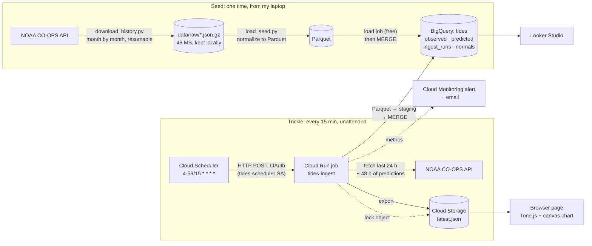

# Tidal Drift: Anchorage tides → BigQuery → ambient music (CS 452 Data Pipeline)

A pipeline that bulk-loaded 62 years of NOAA tide data for Anchorage, Alaska. It keeps itself
current every 15 minutes with nobody pushing the button, and it plays the result as
generative ambient music in the browser.

- **Live page:** https://storage.googleapis.com/cs452-tides-hk-public/index.html (press Play)
- **The pipeline's output file:** https://storage.googleapis.com/cs452-tides-hk-public/latest.json
- **Source:** NOAA CO-OPS station [9455920](https://tidesandcurrents.noaa.gov/stationhome.html?id=9455920),
  water level every 6 minutes, observed and predicted, meters above mean sea level

## Architecture



| Stage | Technology | Why |
|---|---|---|
| Source | NOAA CO-OPS (no key) | Observed **and** predicted tides at the same timestamps, so residual = observed − predicted (the weather's effect on the sea) |
| Seed | Python script → raw files → Parquet → BigQuery **load job** | Download once and keep the raw copy (seeding etiquette). Load jobs are free; streaming inserts are not |
| Ingestion | **Cloud Scheduler → Cloud Run job** | Fires on time (the course reference measured GitHub Actions cron at 2 of ~36 runs vs. Cloud Scheduler 37/37). A job, not a service: it runs, exits and costs nothing in between |
| Buffer | none (see [Why no buffer](#why-no-buffer)) | |
| Store | **BigQuery** (dataset `tides`, US) | Columnar, partitioned by month; 10 GB storage and 1 TB of queries free each month |
| Serving | `latest.json` in a public Cloud Storage bucket | The page never queries BigQuery: one small file per run instead of a query per visitor |
| Alive? | Run ledger table, page status strip, Looker Studio, email alert | |

## Data model ([sql/schema.sql](sql/schema.sql))

- **`observed`** (station, t, water_height, sigma, flags, quality, plus bookkeeping columns
  first_ingested_at, updated_at, run_id). One row per 6-minute reading, 2.73 M rows from 1995 to now.
  `water_height` is NULL when NOAA's quality control blanked the reading (18,758 rows).
- **`predicted`** (station, t, water_height, plus bookkeeping). The astronomical tide, 5.51 M rows,
  1964 → two days ahead.
- Both are **partitioned by month** on `t` (about 380 partitions; daily would exceed BigQuery's
  4,000-partitions-per-query limit) and **clustered by station**. The primary key (station, t)
  is declared but `NOT ENFORCED`, because BigQuery doesn't enforce keys (see Idempotency).
- **`readings`** view: a FULL JOIN of the two (keeping future predictions and gaps), adding residual and
  `reading_status` (observed / failed_qc / predicted_only).
- **`readings_between(lo, hi)`** table function: the same join, but filtered *before* joining.
  Filtering the view on `t` scanned 298 MB per call, because after `FULL JOIN ... USING` the column
  `t` is a COALESCE that hides the partition column. The function scans about 10 MB.
- **`ingest_runs`**: one row per run, with trigger, window, rows fetched/inserted/updated,
  status (`success`, `no_new_data`, `skipped`, `failed`), error and freshness.
- **`normals`** ([sql/normals.sql](sql/normals.sql)): residual and level percentiles per calendar
  month, computed from the seed. This is the "today vs. history" join: the page shows whether
  today's residual is unusual for November.

## Two paths: seed and trickle

**Seed (one time).** [seed/download_history.py](seed/download_history.py) pulled observed data month
by month (NOAA's 31-day limit for 6-minute data) and predictions year by year (1-year limit) into
gzipped raw JSON:
- 376 months with data and 63 years of predictions, 48 MB, 0 failures.
- Writes are atomic (temp file + rename), so it can resume after a crash.
- It pauses 1 s between requests and retries with backoff (2, 4, 8, 16 s); 4xx errors are not retried.

[seed/load_seed.py](seed/load_seed.py) then normalizes the raw files to Parquet, loads them into a
staging table, and MERGEs into the real tables. Re-running it changes nothing (0 inserted,
0 updated).

**Trickle (every 15 minutes).** [pipeline/ingest.py](pipeline/ingest.py) runs as the Cloud Run
job `tides-ingest`, scheduled at `4-59/15 * * * *` UTC (minute 4, not 0, to give NOAA's
6-minute readings time to publish). Each run:
1. Takes a lock (see below), then picks a window: the last 24 h, or from the newest stored
   reading if the table is further behind (automatic backfill, capped at 365 days).
2. Fetches observed readings for the window, and predictions for the window plus 48 h ahead.
3. Writes each to Parquet, loads it into a per-run staging table (expires in 1 h), and MERGEs
   it into the target table, scanning only the window's partitions.
4. Records the run in `ingest_runs` and exports `latest.json` (the last 48 h and next 48 h,
   this month's normals, and the last 200 runs).

A second job, `tides-reverify`, runs daily at 06:30 UTC with a 1,000-hour window. NOAA replaces
preliminary readings (`q = p`) with verified ones (`q = v`) weeks later, and this job picks up
those changes as `obs_updated`.

## Requirements

### 1. Idempotency

Every run re-fetches 24 hours that it mostly already has, so duplicates must be impossible. The
MERGE ([pipeline/bq.py](pipeline/bq.py)) is an upsert keyed on (station, t):
- **No match:** insert the row.
- **Match with a changed value:** update it, using `IS DISTINCT FROM` so NULL-to-value changes count.
  `updated_at` and `run_id` record which run changed it.
- **Match with nothing changed:** leave it alone. The bookkeeping timestamps don't change, so re-runs are true no-ops.
- **Duplicates within one fetch:** `QUALIFY ROW_NUMBER()` removes them first, preferring verified over preliminary.

**Concurrent runs** were the one hole. A scheduled run and a manual run started in the same second.
Both MERGEs saw the same rows as missing, and both inserted them (BigQuery allows concurrent
insert-only MERGEs and enforces no keys). That made 2 duplicate rows, which I found, deleted, and
fixed with a lock ([pipeline/lock.py](pipeline/lock.py)):
- The lock is an object in Cloud Storage created with `if_generation_match=0` ("only if it doesn't
  exist"). Cloud Storage checks that atomically, so exactly one run wins, like Redis `SET NX`.
- The loser records `skipped` and exits cleanly. The next run's overlapping window covers anything it would have fetched.
- A lock older than 15 minutes counts as left behind by a crashed run and is taken over.

Check (should return no rows):
```sql
SELECT station, t, COUNT(*) FROM tides.observed GROUP BY 1, 2 HAVING COUNT(*) > 1;
```

### 2. Gaps and failure handling

- **Seed → trickle gap:** there isn't one by design. The first trickle run found the newest stored
  reading (the end of the seed) older than its 24-hour window, so it widened the window and
  backfilled 457 observations from there, overlapping the seed by one row (harmless, see above).
- **NOAA down at 3 a.m.: backfill, not skip.** The failed run records `failed` with the error and
  exits non-zero. The next run sees the table is behind and fetches from the newest reading, so
  any outage up to 365 days heals itself on the first good run. Backfill instead of skip because
  the data is a continuous time series used for residuals and percentiles, and NOAA keeps it
  available indefinitely.
- **Runs that fetch nothing new are normal.** They record `no_new_data`, not failure. NOAA
  publishes on its own lag (readings are 10–20 minutes old when they appear).
- **Bad readings:** a blank `v` from NOAA (failed quality control) is stored as NULL, not dropped,
  so a gap in the data stays visible (`reading_status = 'failed_qc'`) and is audible on the page (static).
- **Partial runs:** each table's MERGE is a single atomic statement, so a crash leaves each table either fully updated or untouched.
- **Retries:** NOAA requests retry with backoff. Cloud Run retries a failed task once. The
  lock is released in a `finally` block, so a failed run doesn't block the next one.
- **Alerting** ([deploy/alerts.sh](deploy/alerts.sh)): a Cloud Monitoring policy emails me if
  (a) any execution of either job fails, or (b) **no** `tides-ingest` execution finishes for an hour.
  Condition (b) watches for a missing metric. That covers what the job can't report about itself:
  the Scheduler stopping, or the container crashing before it reaches the ledger. Tested by forcing
  a failed execution with a bad environment variable: the failure was recorded at 04:27 UTC and the
  alert email arrived at 04:30 (2026-11-12).
- **The page shows it too:** the status strip turns "late" at 45 minutes and "stale" at 90. Data
  age is routed into the music, so as data goes stale every layer fades out except a drone.

### 3. Secrets management

There are no secrets to manage, by design:
- NOAA needs no API key.
- The Cloud Run job authenticates to BigQuery and Cloud Storage as its own **service account**
  (`tides-ingest`), using Google-managed credentials from the metadata server. No key files exist.
- Cloud Scheduler calls the Cloud Run API with an OAuth token for a second service account
  (`tides-scheduler`) that can only invoke the two jobs.
- **Least privilege:**
  - `tides-ingest` has `bigquery.jobUser` on the project, `bigquery.dataEditor` on the `tides`
    dataset only (SQL `GRANT ... ON SCHEMA`), and `storage.objectUser` on the one bucket.
  - `tides-scheduler` has `run.invoker` on the two jobs only.
- Locally, scripts use my own Application Default Credentials (`gcloud auth application-default login`),
  stored outside the repo.
- `.gitignore` blocks `.env`, `*.key`, `*credentials*.json` and `service-account*.json` anyway.
- The alert email is read from the logged-in gcloud account at deploy time, not stored in the repo.
- The bucket is public on purpose. It holds only `latest.json` (public NOAA data) and the page itself.

### 4. Cost accounting

Measured on 2026-11-11 (BigQuery numbers from `INFORMATION_SCHEMA.JOBS_BY_PROJECT`):

| Resource | Usage | Free tier | Cost |
|---|---|---|---|
| BigQuery storage | 0.58 GB (predicted 353 MB, observed 228 MB) | 10 GB | $0 |
| BigQuery queries | ~105 MB billed per run → ~300 GB/month; 5.8 GB so far this month | 1 TB/month | $0 |
| BigQuery load jobs | seed + one per run | always free | $0 |
| Cloud Run jobs | ~96 runs/day × ~13 s × 1 vCPU / 512 MiB ≈ 38k vCPU-s, 19k GiB-s per month | 180k vCPU-s, 360k GiB-s | $0 |
| Cloud Scheduler | 2 jobs | 3 jobs per billing account | $0 |
| Cloud Storage | ~3,000 writes/month (latest.json + lock); page reads; < 1 MB stored | 5,000 Class A, 50,000 Class B ops | $0 |
| Artifact Registry | 317 MB of container images | 0.5 GB | $0 |
| Cloud Build | 3 source deploys, a few minutes each | free build minutes | $0 |
| Cloud Monitoring alerting | 2 alert conditions | none; billed since 2026 | ~$0.20/month (~$0.10 for this project's life) |
| **Total** | | | **≈ $0.10** |

Billing console (Billing → Reports) as of 2026-11-11: **$0.00** (TODO Hyrum: confirm in the console before submitting). The project has a $1 budget alert.

**The cost bug worth mentioning:** the first deployed version queried the `readings` view
filtered by time and was billed 298 MB per run, about 860 GB a month, close to the 1 TB free
tier. `INFORMATION_SCHEMA` showed the bytes, and switching to the `readings_between` table
function brought it to ~105 MB. Most of that is now BigQuery's 10 MB minimum per table
referenced in each query. The MERGE itself processes about 0.1 MB.

**Teardown** after the one-week follow-up (2026-11-19): `gcloud projects delete cs452-tides-hk`
removes everything at once.

## Proving it's alive

```sql
-- Every run, newest first: trigger, what it did, how fresh the data was
SELECT started_at, run_trigger, status, obs_inserted, obs_updated, pred_inserted, latest_obs_t, error
FROM tides.ingest_runs ORDER BY started_at DESC LIMIT 20;

-- Rows that arrived unattended (the bulk seed is run_id 'seed-…')
SELECT DATE(first_ingested_at) AS day, COUNT(*) AS rows_from_scheduler
FROM tides.observed WHERE run_id LIKE 'tides-ingest-%' GROUP BY day ORDER BY day;

-- Live trickle joined to the historical seed: how unusual is today's water?
SELECT r.t, r.residual,
       n.residual_q[OFFSET(50)] AS typical_november_residual,
       n.residual_q[OFFSET(90)] AS p90
FROM tides.readings_between(TIMESTAMP_SUB(CURRENT_TIMESTAMP(), INTERVAL 6 HOUR), CURRENT_TIMESTAMP()) r
JOIN tides.normals n ON n.station = r.station AND n.month = EXTRACT(MONTH FROM r.t)
WHERE r.reading_status = 'observed' ORDER BY r.t DESC;
```

The page's status strip shows the same ledger: the last run, the newest reading's age, and one
colored square per recent run.

## Why no buffer

Stage 3 (Pub/Sub) is optional. I left it out because this pipeline has nothing to decouple:
- **The producer is a pull.** NOAA doesn't push events. The job asks for a window and gets it all
  at once, about 3 new readings every 15 minutes.
- **The consumer is a batch statement.** One MERGE per run absorbs that whole window
  idempotently, so there's no burst to smooth out and no slow consumer to protect.
- **The source is its own replay log.** If BigQuery is down, NOAA still has the data, and the
  backfill logic fetches it later. A queue would only hold what NOAA already holds.
- **It would add a moving part** (a topic, a subscription, a second consumer to keep alive and
  monitor) to a project whose hardest requirement is staying alive unattended.

A buffer would earn its place with a push source (like the Wikimedia stream) or many producers.

## The music page ([web/](web/), design in [docs/sound-design.md](docs/sound-design.md))

A static page (Tone.js, canvas, no build step) that reads only `latest.json`:
- **Chart:** observed, predicted and the gap between them; this month's typical band; a dotted
  "nowcast" (prediction + latest residual) between pipeline runs; high/low tide markers; and the playhead.
- **Inputs computed in the browser:** water level, rate of change, residual, the residual's
  percentile for this month, today's tidal range, choppiness (sigma) and data age.
- **Modulation matrix:** any input can drive any sound parameter, with an amount (negative
  inverts), input range, curve and smoothing. Defaults:
  - level → filter brightness and pad swell
  - rate → arpeggio direction and density
  - unusual residual → tension and a darker musical mode
  - tidal range → reverb and dynamics
  - sigma → shimmer
  - data age → everything fades to a drone
- **Events:** a bell at each high and low tide, static at a failed-QC reading, and a soft chime
  when the pipeline delivers new data.
- **Modes:** live, or replay of the 4-day window at up to 1 hour of tide per 2 seconds.
- **Fetching:** the page asks for `latest.json` just after each scheduled run (minutes 4, 19, 34,
  49 plus 50 s) instead of polling, about 4 requests an hour per open tab.

## Repo layout and commands

```
seed/download_history.py   one-time download of raw history (resumable)
seed/load_seed.py          raw → Parquet → staging → MERGE
pipeline/ingest.py         the 15-minute job (Cloud Run)
pipeline/{noaa,bq,lock,config}.py
sql/schema.sql             tables, view, table function
sql/normals.sql            monthly percentiles from the seed
deploy/deploy.sh           service accounts, IAM, Cloud Run jobs, Scheduler (re-runnable)
deploy/alerts.sh           email alert policy (re-runnable)
deploy/deploy-web.sh       publish the page to the bucket
web/                       the music page
docs/sound-design.md       data → sound mapping and control panel design
```

```bash
uv sync                                        # Python 3.13 environment
uv run python -m seed.download_history         # once
bq query --nouse_legacy_sql < sql/schema.sql
uv run python -m seed.load_seed
uv run python -m pipeline.ingest               # one run locally
bash deploy/deploy.sh && bash deploy/alerts.sh && bash deploy/deploy-web.sh
```
